# Domänenmodell

Fachliche Objekte des Moduls «Handlungen» (PDCA: Planung → Umsetzung → Evaluation / Auswertungen) inklusive der zugehörigen Einstellungen.

```mermaid
classDiagram
    class Klientin {
        Vorname : Text
        Nachname : Text
        Dossier : Text
        Laufnummer : Text
    }
    class ThemaZiel {
        Bezeichnung : Text
        Freitext : Text
        Gültig ab : Datum
        Gültig bis : Datum
        Status : Zielstatus [Aktiv, Abgeschlossen]
    }
    class Zielbeurteilung {
        Ziel erreicht : Zielerreichung [Ja, Nein, Teilweise]
        Auswertung : Text
        Abgeleitete Massnahmen : Text
        Beurteilt von : Text
        Beurteilt am : Datum/Zeit
    }
    class Handlung {
        Bezeichnung : Text
        Beschreibung : Text
        Weitere Hilfsmittel : Text
        Geplante Minuten : Zahl
        Anz. Personen : Zahl
        Resultat : Resultaterfordernis [Kein Resultat, Resultat optional, Resultat zwingend]
        Gültig ab : Datum
        Gültig bis : Datum
        Wiederholung : Wiederholungsart [Täglich, Wöchentlich, Monatlich, Nach Bedarf]
        Wochentage : Wochentag mehrfach [Mo, Di, Mi, Do, Fr, Sa, So]
        Muster : Monatliche Regel [Erster Tag im Monat, Erster Montag im Monat, Letzter Tag im Monat, Letzter Freitag im Monat]
        Planungsart : Planungsart [Geplant, Ungeplant, Nach Bedarf]
        Optionale Leistungsarten : Leistungsart mehrfach [Spitex KLV a, Spitex KLV b, Spitex KLV c, Verbrauchsmaterial Tape 1m, Verbrauchsmaterial Elektrodenset 4, Zuschlag Physio]
    }
    class Durchfuehrung {
        Tageszeit : Tageszeit [Morgen, Mittag, Nachmittag, Abend, Nacht]
        Uhrzeit : Uhrzeit
    }
    class Leistungseintrag {
        Leistungsart : Leistungsart [Spitex KLV a, Spitex KLV b, Spitex KLV c, Verbrauchsmaterial Tape 1m, Verbrauchsmaterial Elektrodenset 4, Zuschlag Physio]
        Max. Min. : Zahl
        Reihenfolge : Zahl
    }
    class Umsetzung {
        Datum : Datum
        Status : Umsetzungsstatus [Offen, Durchgeführt, Mit Abweichung durchgeführt, Nicht durchgeführt, Verschoben]
        Tatsächliche Minuten : Zahl
        Tatsächliche Anzahl Personen : Zahl
        Begründung : Text
        Resultat : Text
        Beobachtungen : Text
        Leistungsart bei Umsetzung : Leistungsart [Spitex KLV a, Spitex KLV b, Spitex KLV c, Verbrauchsmaterial Tape 1m, Verbrauchsmaterial Elektrodenset 4, Zuschlag Physio]
        Tageszeit bei Umsetzung : Tageszeit [Morgen, Mittag, Nachmittag, Abend, Nacht]
        Bestätigt von : Text
        Bestätigt am : Datum/Zeit
        Neues Datum : Datum
        Neue Tageszeit : Tageszeit [Morgen, Mittag, Nachmittag, Abend, Nacht]
        Neue Uhrzeit : Uhrzeit
        Verschiebungsgrund : Text
        Verschoben von : Text
        Verschoben am : Datum/Zeit
    }
    class ErfassteOptionaleLeistung {
        Leistungsart : Leistungsart [Spitex KLV a, Spitex KLV b, Spitex KLV c, Verbrauchsmaterial Tape 1m, Verbrauchsmaterial Elektrodenset 4, Zuschlag Physio]
        Anzahl : Zahl
    }
    class Handlungsvorlage {
        Code : Text
        Titel : Text
        Beschreibung : Text
        Geplante Dauer : Zahl
        Anz. Personen : Zahl
        Resultat : Resultaterfordernis [Kein Resultat, Resultat optional, Resultat zwingend]
        Wiederholung : Wiederholungsart [Täglich, Wöchentlich, Monatlich, Nach Bedarf]
        Wochentage : Wochentag mehrfach [Mo, Di, Mi, Do, Fr, Sa, So]
        Monatliche Regel : Monatliche Regel [Keine Angabe, Erster Tag, Erster Wochentag, Erster Montag, Letzter Tag, Letzter Wochentag, Letzter Freitag]
        Kategorie veränderbar : Ja/Nein
        Optionale Leistungsarten : Leistungsart mehrfach [Spitex KLV a, Spitex KLV b, Spitex KLV c, Verbrauchsmaterial Tape 1m, Verbrauchsmaterial Elektrodenset 4, Zuschlag Physio]
    }
    class Feldvorgabe {
        Feld : Vorlagenfeld [Titel, Beschreibung, Hilfsmittel, Geplante Dauer, Anz. Personen, Klassifizierung, Tageszeit, Resultat, Wiederholung, Monatliche Regel, Wochentage]
        Veränderbar : Ja/Nein
        Zwingend : Ja/Nein
    }
    class Disziplin {
        Titel : Text
    }
    class Kategorie {
        Code : Text
        Bezeichnung : Text
    }
    class Klassifizierung {
        Bezeichnung : Text
    }
    class Rolle {
        Bezeichnung : Text
    }
    class Hilfsmittel {
        Name : Text
        Beschreibung : Text
    }
    class Vorlagenzeitangabe {
        Tageszeit : Tageszeit [Morgen, Mittag, Nachmittag, Abend, Nacht]
        Uhrzeit : Uhrzeit
    }

    Klientin "1" --> "0..*" ThemaZiel : verfolgt
    Klientin "1" --> "0..*" Handlung : erhält ungeplant
    ThemaZiel "0..*" --> "1" Disziplin : gehört zu
    ThemaZiel "1" --> "0..1" Zielbeurteilung : wird beurteilt durch
    ThemaZiel "1" --> "0..*" Handlung : wird erreicht durch
    Handlung "0..*" --> "0..1" Handlung : entstanden aus Bedarfs-Handlung
    Handlung "0..*" --> "0..1" Handlungsvorlage : basiert auf
    Handlung "0..*" --> "0..1" Kategorie : ist eingeteilt in
    Handlung "0..*" --> "0..1" Klassifizierung : ist klassifiziert als
    Handlung "0..*" --> "0..*" Hilfsmittel : benötigt
    Handlung "1" --> "0..*" Leistungseintrag : wird abgerechnet mit
    Handlung "1" --> "1..*" Durchfuehrung : wird durchgeführt als
    Durchfuehrung "1" --> "0..*" Umsetzung : wird umgesetzt in
    Umsetzung "1" --> "0..*" ErfassteOptionaleLeistung : enthält
    Handlungsvorlage "0..*" --> "0..*" Disziplin : gilt für
    Handlungsvorlage "0..*" --> "0..1" Kategorie : ist eingeteilt in
    Handlungsvorlage "0..*" --> "0..1" Klassifizierung : ist klassifiziert als
    Handlungsvorlage "0..*" --> "0..*" Hilfsmittel : sieht vor
    Handlungsvorlage "1" --> "0..*" Vorlagenzeitangabe : sieht vor
    Handlungsvorlage "1" --> "0..*" Leistungseintrag : wird abgerechnet mit
    Handlungsvorlage "1" --> "0..*" Feldvorgabe : legt fest
    Disziplin "0..*" --> "0..*" Kategorie : verwendet
    Disziplin "0..*" --> "0..*" Rolle : berechtigt
    Klassifizierung "0..*" --> "0..*" Rolle : darf umsetzen
    Hilfsmittel "0..*" --> "0..*" Disziplin : gilt für
```

## Erläuterungen

- **Klientin** steht für «Klient/in». **ThemaZiel** steht für «Thema / Ziel». **Durchfuehrung** und **ErfassteOptionaleLeistung** stehen für «Durchführung» und «Erfasste optionale Leistung». Mermaid erlaubt in Klassennamen keine Sonderzeichen.
- **Datentyp «Uhrzeit»:** zusätzlicher fachlicher Datentyp für Stunden und Minuten (hh:mm).
- **Tageszeit** ist eine feste Aufzählung (Morgen, Mittag, Nachmittag, Abend, Nacht) ohne Zeitfenster. Sie ist nicht konfigurierbar.
- **«mehrfach»** bedeutet: Das Attribut kann mehrere Werte der Aufzählung enthalten.
- **Leistungsart:** Die Werte heissen in der Oberfläche «Spitex, KLV a» und «Verbrauchsmaterial Elektrodenset (4)». Komma und Klammern sind im Diagramm weggelassen.

### Klient/in, Thema / Ziel, Zielbeurteilung

- **Laufnummer** wird vom System vergeben und erscheint nur in Exporten.
- **Zielstatus:** Ein Thema / Ziel ist «Abgeschlossen», sobald «Gültig bis» vor dem heutigen Datum liegt, sonst «Aktiv».
- Bei einem abgeschlossenen Thema / Ziel ist alles schreibgeschützt: Bezeichnung, Freitext, Daten, Handlungen und Umsetzungen.
- Eine **Zielbeurteilung** ist nur für abgeschlossene Themen / Ziele möglich. «Beurteilt von» und «Beurteilt am» setzt das System.

### Handlung und Durchführung

- Eine **Handlung** ist das, was die Benutzerin plant. Jede Handlung hat 1..n **Durchführungen**:
  - ohne Tageszeit genau eine («Ohne Zeitangabe»),
  - pro gewählter Tageszeit eine ohne Uhrzeit oder eine pro Uhrzeit.
- **Tageszeit und Uhrzeit:**
  - Die Tageszeit ist optional.
  - Eine Uhrzeit gibt es nur zusammen mit einer Tageszeit. Sie wird nicht plausibilisiert, «Mittag, 23:30» ist zulässig.
  - Mehrere Durchführungen derselben Tageszeit brauchen je eine eigene, unterschiedliche Uhrzeit.
- **Fälligkeit:** Eine Durchführung ist immer am geplanten Datum fällig, auch «Nacht, 02:00».
- Jede Durchführung hat ihre eigene Umsetzungshistorie.
- **Planungsart:**
  - «Geplant»: Die Handlung gehört zu einem Thema / Ziel.
  - «Ungeplant»: Die Handlung hängt direkt an der Klient/in und gilt für einen einzelnen Tag.
  - «Nach Bedarf»: eine Durchführung für einen einzelnen Tag, entstanden aus einer geplanten Handlung mit Wiederholung «Nach Bedarf».
- **Gesperrte Felder:** Felder, deren Feldvorgabe «veränderbar = Nein» hat, sind in der Handlung gesperrt. Felder mit «zwingend = Ja» sind Pflichtfelder.
- **Leistungseinträge:** Alle Einträge ausser dem letzten brauchen «Max. Min.», der letzte hat keine. Dieselbe Leistungsart darf nicht mehrfach vorkommen.

### Umsetzung

- Pro Durchführung und ursprünglichem Datum gibt es höchstens eine **Umsetzung**.
- «Offen» ist der Ausgangszustand jedes fälligen Termins.
- «Leistungsart bei Umsetzung» und «Tageszeit bei Umsetzung» halten den Stand zum Zeitpunkt der Bestätigung fest, nach einer Neuplanung mit deren Tageszeit. Spätere Änderungen am Plan verändern sie nicht.
- **Neuplanung:** Sie kann Datum, Tageszeit und Uhrzeit ändern. Eine neue Uhrzeit ist nur mit einer Tageszeit möglich.
- **Quittierung:** Bestätigen ist ab der (neu geplanten) Uhrzeit möglich, ohne Uhrzeit ab Beginn des Tages.
- **Anzeige in der Umsetzung:** Pro Tag erscheinen die Abschnitte in der Reihenfolge Ohne Zeitangabe, Nacht, Morgen, Mittag, Nachmittag, Abend.
- Bei «Durchgeführt» übernimmt das System die geplanten Minuten und Personen als tatsächliche Werte. Diese bleiben auch dann gespeichert, wenn der Plan später geändert wird.

### Einstellungen

- **Handlungsvorlage:** Titel ist zwingend, wenn die Feldvorgabe «Titel» nicht veränderbar ist.
- **Feldvorgabe:** «Zwingend» ist nur möglich, wenn «Veränderbar» = Ja.
- **Vorlagenzeitangabe:** Die Vorlage gibt Tageszeiten mit optionalen Uhrzeiten vor. Es gelten dieselben Regeln wie bei der Handlung.
- **Klassifizierungen:** Es gibt fest drei, «KLV A», «KLV B» und «KLV C». Ohne berechtigte Rollen darf jede Person umsetzen.
- **Rollen** sind fest vorgegeben und nicht bearbeitbar.
