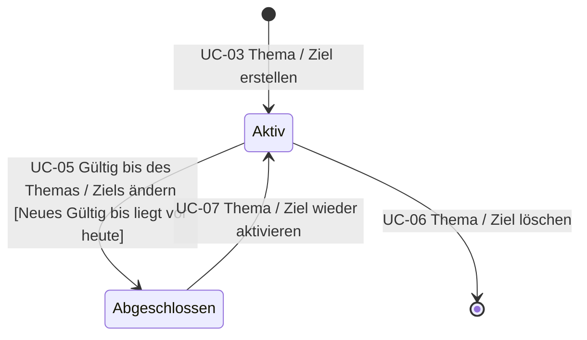

# State Chart: Thema / Ziel

Ein Thema / Ziel wechselt auch ohne Benutzeraktion von «Aktiv» zu «Abgeschlossen», sobald das Gültig bis vor dem heutigen Datum liegt. Dazu gibt es keinen Use Case (siehe Konsistenzprüfung).
