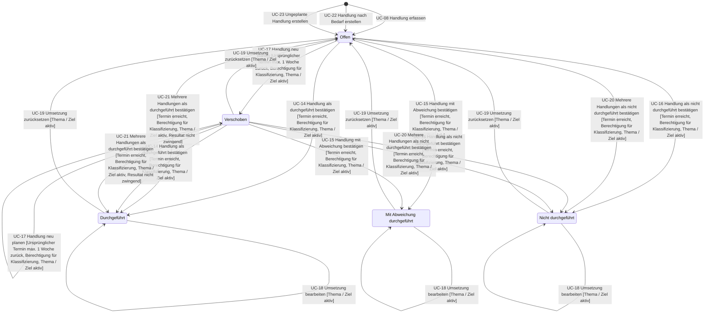

# State Chart: Umsetzung

Eine Umsetzung gehört zu einer Durchführung an einem ursprünglich geplanten Datum.

Löschen: Eine Umsetzung endet, wenn ihre Handlung gelöscht wird. Das geschieht in UC-06, UC-09 (Entfernen einer Durchführung), UC-10, UC-24 und UC-25. Weil das aus jedem Zustand möglich ist, sind diese Übergänge zur Lesbarkeit nicht eingezeichnet.
